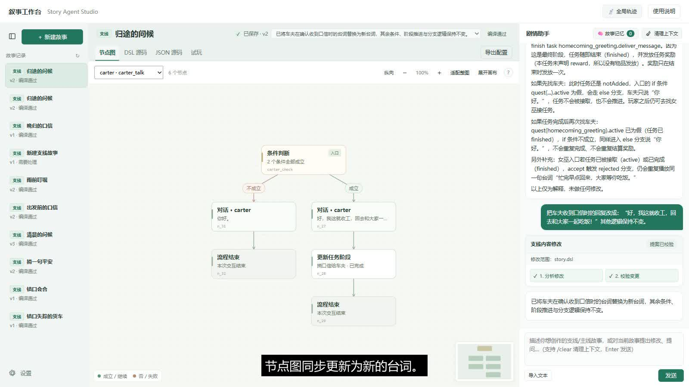

# Story Agent Studio

### 把写好的故事，变成可以玩的游戏剧情。

一个面向游戏叙事创作的 Agent 工作台：输入故事，用节点图理解流程，通过对话调整内容，再进入游戏验证效果。

[**在线体验 →**](https://paparship.github.io/story-agent-studio/) · [**视频与功能介绍 →**](https://paparship.github.io/story-agent-studio/showcase/) · [快速开始](#快速开始)

[](https://paparship.github.io/story-agent-studio/showcase/#demo)

**约 3 分钟演示 · 中文字幕**  
输入支线故事 → 生成 DSL 与节点图 → 向 Agent 提问 → 游戏试玩 → 修改台词 → 接受提案 → 再次试玩。

## 解决什么问题

故事已经写好了，怎样把它放进游戏？传统流程需要逐个创建节点、连接分支、查找角色与资源、填写任务属性，再反复运行检查。

Story Agent Studio 把这些步骤放进同一个创作流程。作者描述人物、对话和剧情条件，Agent 结合游戏资源生成可编译的 DSL；作者可以查看结构、提出问题、审阅修改，并在游戏里确认最终表现。

## 功能特性

### ✦ 从故事到可运行剧情

用自然语言描述人物、台词、任务目标和分支。工作流完成故事理解、资源对应、DSL 生成和编译校验，并展示各阶段的运行进度。编译诊断会返回给模型进行修正。

### ◇ 可视化节点图

将对话、条件、任务推进和行为编排展示成节点图。支持缩放、平移、适配整图与节点详情；同一故事的不同交互入口可以切换查看。

### ↗ 随时向剧情助手提问

询问“什么时候完成任务”“先找另一个角色会怎样”“为何不会重复领奖”。Agent 结合当前故事解释行为，普通问答保持已有配置与版本。

### ⌘ 可读、可编辑的 DSL

台词直接写入剧本，角色、条件、任务与行为明确表达。支持手动修改 DSL、编译诊断和只读 JSON 预览，让自然语言、结构图和运行配置相互衔接。

### ⤺ 修改提案与版本记录

通过聊天提出局部调整，查看变更内容和校验结果，再接受或放弃提案。保存版本可回看、回滚；草稿与待确认修改具有明确状态。

### ▤ 主线章节工作区

将主线组织为章节总览和单章剧情两层。规划章节与分支，进入各章节查看节点图、编辑 DSL 和试玩，切换章节时保留当前查看方式。

### ▶ 在游戏里验证

将已保存的配置加载到 Unity WebGL 试玩环境。通过角色交互观察台词与任务推进，结合实时任务状态检查结果，再回到工作台继续调整。

### ⚙ 浏览器端工作流

TypeScript 编译器、工作流和版本存储运行在浏览器。使用默认模型服务，或在设置中接入 OpenAI 兼容 API。故事记录保存在浏览器中，配置可导出。

## 视频演示了什么

《归途的问候》是一段独立支线：女巫请玩家给车夫捎口信，玩家找到车夫完成任务。演示先生成这段故事并询问完成条件，然后进入游戏跑通；接着通过聊天修改车夫回复，接受提案保存为新版本，再次进入游戏看到新台词。

## 快速开始

需要 **Node.js 22** 与 **pnpm 11**。

```sh
git clone https://github.com/paparship/story-agent-studio.git
cd story-agent-studio
pnpm install
cp .env.example .env.local
pnpm dev
```

打开终端显示的本地地址，在「设置」中配置 OpenAI 兼容服务的 API 地址、模型名称和 Key，即可开始创作。

```sh
pnpm test   # 编译器、工作流、存储与流式客户端测试
pnpm build  # 生成静态站点 dist/
```

[部署与游戏适配](docs/deployment.md) · [项目结构](docs/architecture.md) · [贡献指南](CONTRIBUTING.md)

## 开源许可

工作台源码采用 [MIT License](LICENSE)。游戏适配与依赖的来源见 [第三方说明](THIRD_PARTY_NOTICES.md)。
